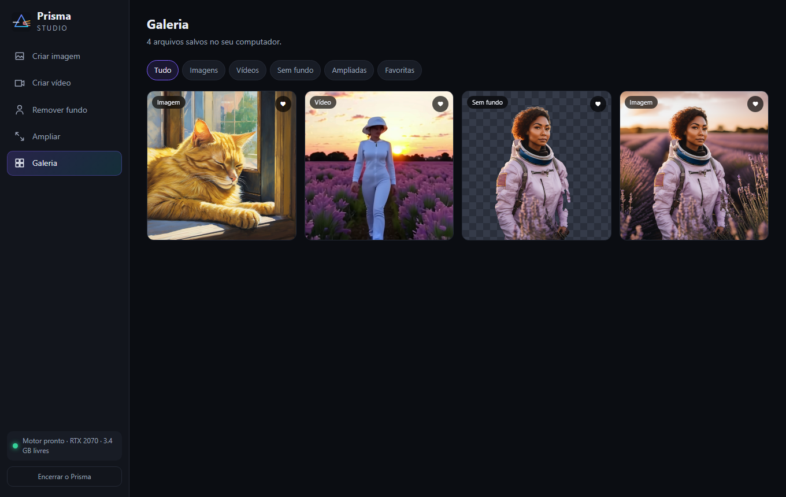

# Prisma Studio

Estúdio local de imagens e vídeos com IA para Windows. Tudo roda no seu computador, sem enviar nada para a internet e sem filtros de nuvem.

- **Criar imagem** (SDXL e FLUX.1 schnell), **criar vídeo** (LTX-Video, texto ou imagem para vídeo), **remover fundo** (BiRefNet), **ampliar** até 4× (Real-ESRGAN) e **galeria** local.
- Pode escrever em português: um modelo pequeno (Qwen2.5 1.5B), também local, traduz o texto para o inglês antes de gerar, e você pode revisar a tradução.
- Janela própria (`Prisma.exe` abre o Edge em modo aplicativo); ao fechar a janela, o motor desliga e libera a placa de vídeo.

## IA online (opcional)

Na aba **IA online** dá para cadastrar a sua chave da [fal.ai](https://fal.ai) e usar modelos maiores na nuvem (FLUX dev, FLUX schnell e FLUX 1.1 pro) em Criar imagem. É pago por imagem, na sua conta da fal.ai. A chave fica só em `config/chaves.json` (fora do Git) e nunca volta para a tela. Atenção: nos modelos online o texto vai para a fal.ai, que tem filtro de conteúdo próprio; os modelos locais continuam sem enviar nada para a internet. `node tools/teste_online.mjs` testa a integração com um servidor falso, sem gastar nada.

## Como é feito

`Prisma.exe` (C#, `launcher/`) liga um servidor Node (`app/server.mjs`, sem dependências) que controla o [ComfyUI](https://github.com/comfyanonymous/ComfyUI) como motor, monta os fluxos (`app/lib/workflows.mjs`), mantém a fila de trabalhos e a galeria. A interface é HTML, CSS e JavaScript puros (`app/public/`).

## Requisitos

Windows 10/11, placa NVIDIA com 8 GB de VRAM ou mais (testado numa RTX 2070 de 8 GB), 16 GB de RAM e memória virtual (arquivo de paginação) grande, de uns 32 GB ou mais, porque os modelos são carregados do disco. Cerca de 40 GB livres para os modelos.

## Instalação

Os modelos e o motor não ficam neste repositório (são ~36 GB).

1. Baixe o ComfyUI portátil para NVIDIA (`ComfyUI_windows_portable_nvidia_cu126.7z`, versão 0.43.0 ou mais nova) em https://github.com/comfyanonymous/ComfyUI/releases e extraia em `engine/` (ficando `engine/ComfyUI_windows_portable/`).
2. Em `engine/ComfyUI_windows_portable/ComfyUI/custom_nodes/`, clone [ComfyUI-GGUF](https://github.com/city96/ComfyUI-GGUF) e instale os pacotes `gguf` e `onnxruntime-gpu` no Python embutido (`python_embeded`).
3. Rode `python tools/baixar_modelos.py` (baixa e confere o SHA-256 de cada modelo; pode rodar de novo para retomar).
4. Coloque o `node.exe` (Node 20 ou mais novo) em `runtime/`.
5. Compile o lançador com `powershell -File launcher/compilar.ps1` e abra `Prisma.exe`.

Para desenvolver sem o lançador: `node app/server.mjs` e abra http://127.0.0.1:8765/.

## Limites honestos

- Vídeos têm 2 a 3 segundos e resolução média; o LTX-Video é bem melhor que o Wan 1.3B em anatomia.
- Uma imagem SDXL 1024² leva ~50 s e um vídeo ~45 s nessa placa; modelos maiores não cabem em 8 GB.
- O app só escuta em 127.0.0.1 e confere o cabeçalho Host. Sem filtro de conteúdo não significa sem responsabilidade: use de acordo com a lei e com as licenças dos modelos.

Licenças de terceiros: veja [LICENCAS.md](LICENCAS.md). Código do Prisma Studio: MIT.
